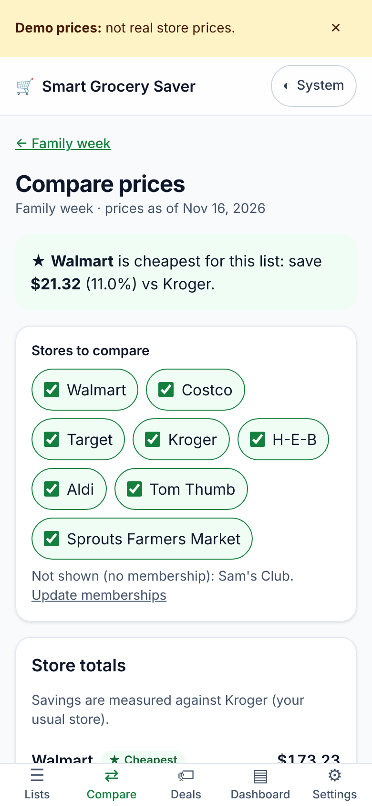
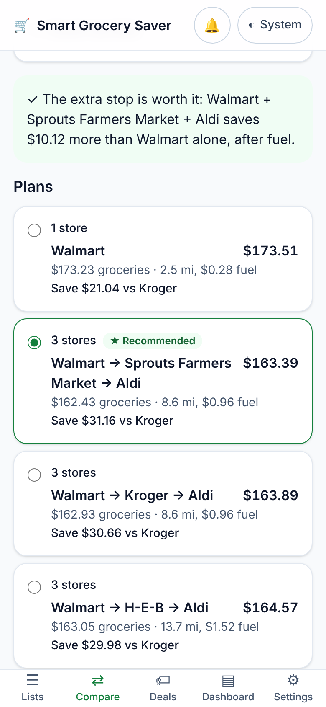
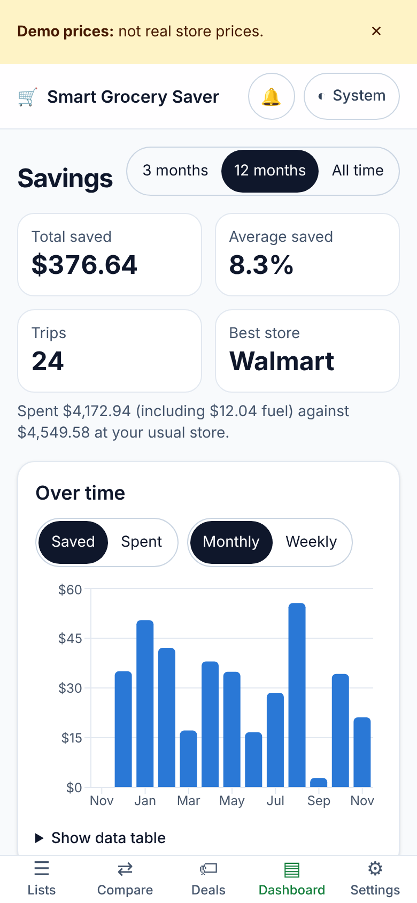

# Smart Grocery Saver

Compare grocery prices across Dallas–Fort Worth stores and decide whether one store or a multi-store run is
worth the drive. The aim: help families cut grocery spending by 10–25%.

Stores: Walmart, Costco, Sam's Club, Target, Kroger, H-E-B, Aldi, Tom Thumb, Sprouts and Trader Joe's.

> **Demo prices.** Store names are real, but every price comes from a built-in mock provider (`PRICE_PROVIDER=mock`)
> with 12 months of simulated history. The app shows a "Demo prices" banner while it runs on mock data.

| Compare a list | Plan your trip | Savings dashboard |
|---|---|---|
|  |  |  |

## What it does

- **Grocery lists:** type items or search the catalog, start from templates, or import pasted text or a CSV file.
- **Price comparison:** what your list costs at each store, the cheapest store, unit prices ($/oz, $/lb, $/ea) and
  your saving against your usual store. Member and loyalty-card prices count only if you have the card.
- **Plan your trip:** the best single store versus the best 2- or 3-store run, including fuel and, if you like,
  your time. A recommendation says whether the extra stop is worth it.
- **Price history and alerts:** 30-day, 90-day and 1-year charts per store, and alerts at a 1-year low or a target
  price.
- **Savings dashboard:** log what you bought, then track total saved, savings per month, and savings by store and
  category. Export to CSV or PDF.
- Mobile-first, with dark mode. Sign in with email and password, or Google (mocked locally).

## Run it locally

You need **Node.js 22.12 or newer**, **Docker Desktop** (running) and **Git**. pnpm is pinned by the repository and
enabled through Corepack.

```bash
git clone https://github.com/st-veng/smart-grocery-saver.git
cd smart-grocery-saver
corepack enable          # once per machine: provides the pinned pnpm 10
pnpm install
pnpm db:up               # PostgreSQL 17 in Docker, on port 5433
pnpm db:reset            # create the database and load demo data (~20 s)
pnpm dev                 # API on :4000, web app on :5173
```

Open **http://localhost:5173** and sign in as **`demo@sgs.test`** / **`demo-password-123`**, or create an account.
"Continue with Google" runs in mock mode when no Google credentials are set.

The demo data has 10 stores and about 190 products with a year of price history, plus a demo user with a
"Family week" list and 24 past trips.

No `.env` file is needed: the defaults match `docker-compose.yml`. To change something (ports, fuel price, test
settings), copy `.env.example` to `.env` and edit it.

**Next time:** `pnpm db:up`, then `pnpm dev`. Stop the app with Ctrl+C and Postgres with `pnpm db:down`.

### Things to try

1. **Lists → Family week → Compare prices** to see each store's total and the cheapest store.
2. On Compare, tap **"Plan my trip: one store or more?"** to compare single- and multi-store runs. Then tap
   **"I shopped this"**.
3. **Dashboard** for savings charts, trip history and CSV/PDF export.
4. **A price alert:** open *Pure Clover Honey* and tap "Alert me at a 1-year low". Stop the app, run
   `pnpm sim:advance --days 1` (moves the mock market forward a day, which triggers a planted Walmart clearance),
   then run `pnpm dev` again. The bell shows the notification.

### Troubleshooting

- **Port 5433 or 5173 already in use:** stop the other program, or set `DATABASE_URL` / ports in `.env`.
- **"Too many attempts" when signing in:** sign-in is rate-limited. Restart `pnpm dev` to reset it.
- **No Docker:** `pnpm db:up` falls back to a local PostgreSQL installation if it finds one.

## Commands

| Command | Does |
|---|---|
| `pnpm dev` | API (:4000) and web app (:5173, proxies `/api` to the API) |
| `pnpm db:up` / `pnpm db:down` | start / stop PostgreSQL |
| `pnpm db:reset` | drop, migrate and seed the dev database |
| `pnpm db:seed` | wipe app data and re-seed (keeps the schema) |
| `pnpm sim:advance [--days N \| --to YYYY-MM-DD]` | move the mock market forward and evaluate price alerts |
| `pnpm typecheck` / `pnpm lint` | TypeScript and ESLint + Prettier |
| `pnpm test` | unit, API and database tests (Vitest) |
| `pnpm test:e2e` | browser tests (Playwright, mobile and desktop) |
| `pnpm verify` | everything above: the gate every change must pass (~6 min) |

The first time you run the browser tests, install their browser:
`pnpm --filter @sgs/e2e exec playwright install chromium`.

## How it's built

A pnpm monorepo in TypeScript:

| Path | What |
|---|---|
| `apps/web` | React 19, Vite, Tailwind CSS 4, TanStack Query, Recharts |
| `apps/api` | Express 5 REST API (`/api/v1`), Zod validation, cookie sessions, CSV and PDF export |
| `packages/core` | pure domain logic: units, unit prices, comparison, price history, trip optimizer |
| `packages/shared` | Zod schemas shared by the API and the web app (the API contract) |
| `packages/db` | PostgreSQL schema and migrations (Drizzle) |
| `packages/pricing` | price-provider interface, mock provider, ingestion pipeline, seed data |
| `e2e` | Playwright tests with accessibility checks (axe) |

Money is stored as integer cents and quantities in base units (g, ml, each). Price dates use the America/Chicago
calendar.

## Documentation

- [`SPEC.md`](SPEC.md): product and technical spec, data model, API, and per-phase acceptance criteria and notes.
- [`OPEN_QUESTIONS.md`](OPEN_QUESTIONS.md): decisions and assumptions.
- [`CLAUDE.md`](CLAUDE.md): working conventions and the full command reference.
- [`docs/screenshots`](docs/screenshots): screenshots from each phase.

The app was built in seven reviewed phases, and `main` (like each `phase-*` branch) has the finished app. To see
the code as it was at the end of a phase, check out its commit, for example `git checkout cdfee6a`:

| Phase | What it added | Commit |
|---|---|---|
| 1 | Scaffold: monorepo, Postgres, migrations, mock pricing seed | `cdfee6a` |
| 2 | Auth: email/password and Google, sessions, onboarding, settings | `8117f4d` |
| 3 | Grocery lists: editing, templates, search, CSV/text import | `44aefd5` |
| 4 | Price comparison: unit prices, cheapest store, savings | `82f94e3` |
| 5 | Price history and alerts | `353545c` |
| 6 | Savings dashboard, trips, CSV/PDF export | `ec006ed` |
| 7 | Single- vs multi-store optimizer | `e897776` |
